# Invoice Processing System

Full-stack app for uploading invoices (PDF / image), processing them
asynchronously, tracking status in real time, viewing the extracted data,
retrying failures, and talking to an AI assistant that **answers questions and
takes actions** against the invoices.

Every invoice moves through:

```text
uploaded → processing → completed / failed        (failed → processing on retry)
```

## 🚀 Live deployment

The app is **deployed and running** — frontend on Vercel, backend on Railway
(Postgres + Redis + Cloudflare R2 for file storage):

- **🔗 Live app:** <https://invoice-prc.vercel.app> — sign in with **admin / admin**.
- **API base URL:** <https://invoice-prc-production.up.railway.app>
- **Interactive API docs (Swagger):** <https://invoice-prc-production.up.railway.app/docs>
  — click **Authorize** and paste a JWT from `POST /auth/login` (default
  **admin / admin**) to try the endpoints.
- **Health check:** <https://invoice-prc-production.up.railway.app/health>

| Layer | Host | URL |
|---|---|---|
| Frontend | Vercel | <https://invoice-prc.vercel.app> |
| Backend API | Railway | <https://invoice-prc-production.up.railway.app> |
| Database / Queue | Railway | PostgreSQL + Redis |
| File storage | Cloudflare R2 | S3-compatible bucket |

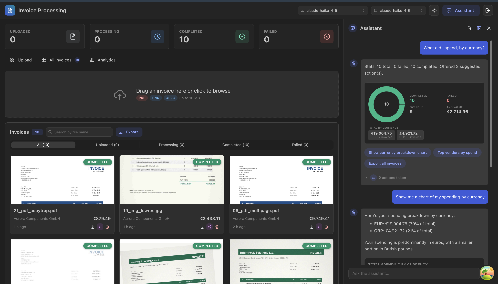

## Highlights

- **Async pipeline** — uploads return instantly; a BullMQ worker on Redis does
  the extraction, with retries/backoff and a rate limiter that protects free-tier
  AI quota.
- **Real-time** — a Socket.IO gateway pushes `invoice.created/updated/deleted`;
  the UI patches its cache live, no polling, no manual refresh. A live
  per-attempt processing timeline shows which engine is reading the document.
- **AI extraction with fallback cascade** — Claude / Gemini vision read the
  document; if one engine produces a weak result the next is tried, and the best
  attempt wins. A PDF text-layer + Groq fallback handles edge cases.
- **AI assistant (answer + act)** — a tool-using chat (15 tools) that finds &
  filters, analyses, charts, retries, re-checks, **edits fields**, deletes (with
  confirmation), exports, suggests next steps as clickable buttons, and drives
  the UI. Streams its live progress and runs on Groq / Claude / Gemini,
  switchable at runtime.
- **Anti-hallucination guards** — the assistant never acts on an invented id
  (UUID guard + find-then-act), gates every destructive action behind a
  confirmation, and strips ungrounded references from its replies.
- **Export** — download the filtered invoices as **Excel, CSV, or a ZIP** of the
  original files, from a button or by asking the assistant.
- **Single-user auth** — username/password login issues a JWT used by both the
  REST API and the WebSocket handshake.

## Stack

| Layer        | Choice                                                            |
|--------------|------------------------------------------------------------------|
| Backend      | NestJS + TypeScript                                              |
| Frontend     | React + TypeScript (Vite), Mantine UI, React Query, Socket.IO    |
| Database     | PostgreSQL (TypeORM, `jsonb` for extracted data)                |
| Queue / Jobs | Redis + BullMQ (async processing, retries, rate limiting)       |
| Real-time    | Socket.IO (`@nestjs/websockets`) + SSE for assistant progress   |
| AI           | Claude (`claude-haiku-4-5`), Google Gemini, Groq — multi-engine |
| Infra        | Docker Compose (postgres, redis, optional backend)              |

## Screenshots

| | |
|---|---|
| **Assistant welcome** — what it can do, with clickable examples<br>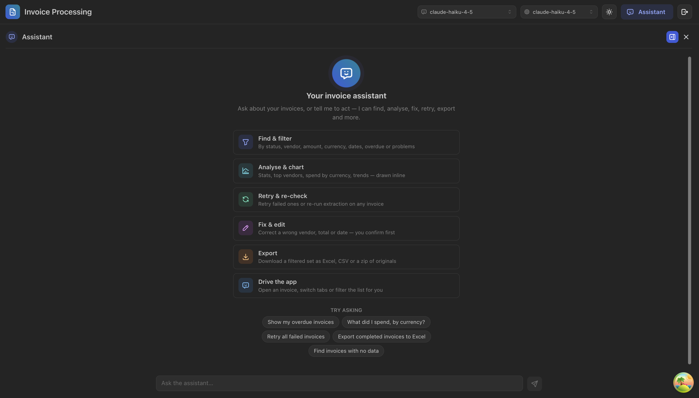 | **Stats + suggested actions** — inline donut, totals, clickable next steps<br>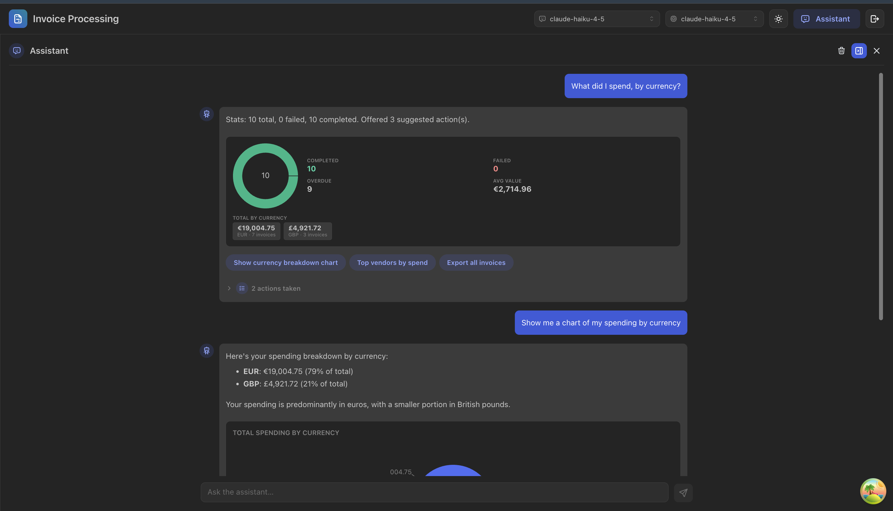 |
| **Inline charts** — the assistant draws real charts from server stats<br>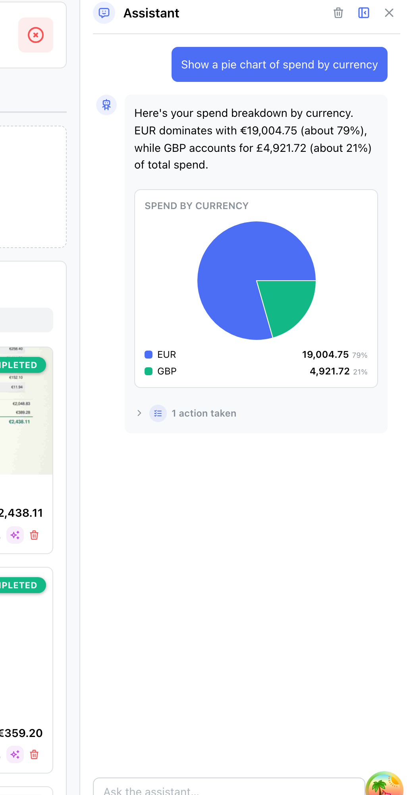 | **Invoice detail** — extracted data, line items, processing timeline<br>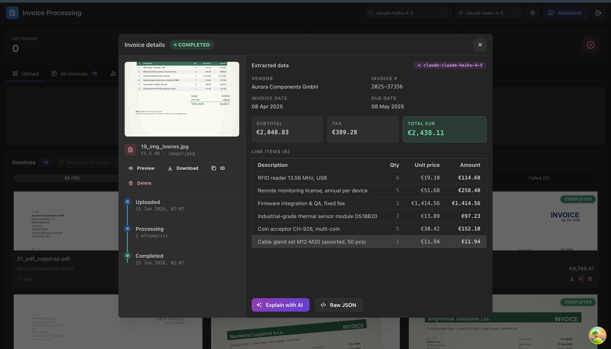 |
| **Live processing** — see each extraction step as it happens<br>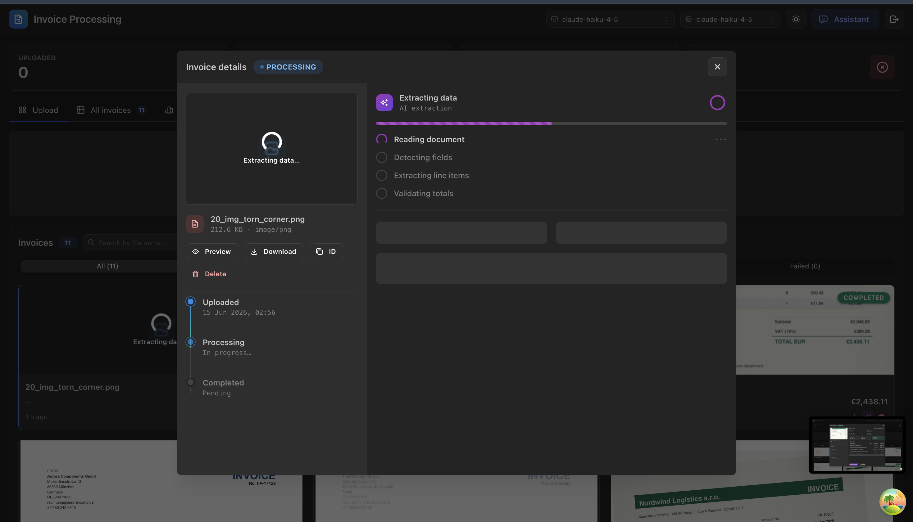 | **Document preview** — the original PDF/image inline<br>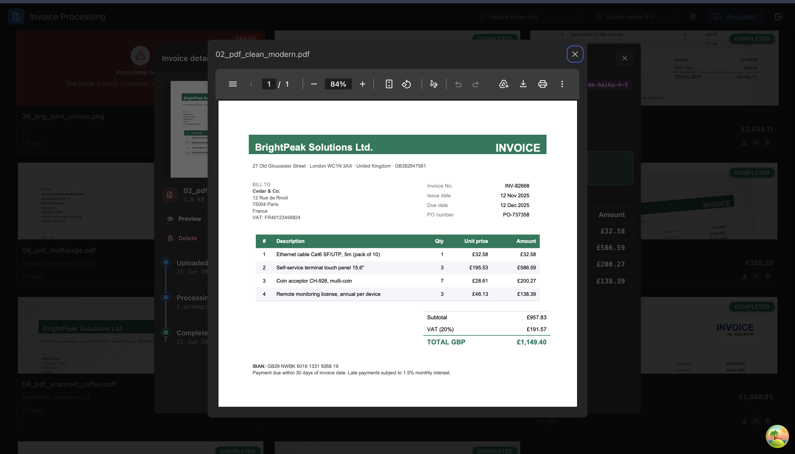 |
| **Analytics** — status, top vendors, spend by currency, trend<br>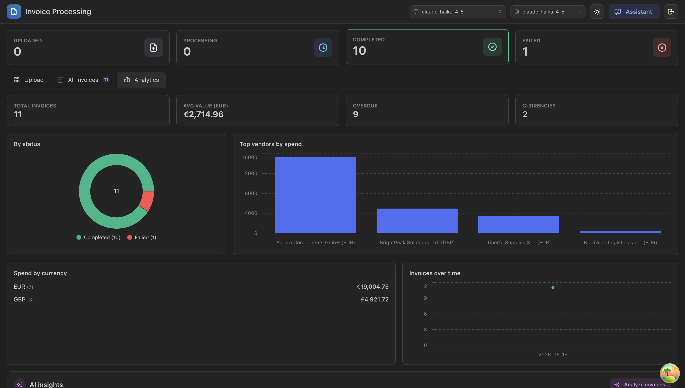 | **Export** — Excel / CSV / ZIP of originals<br>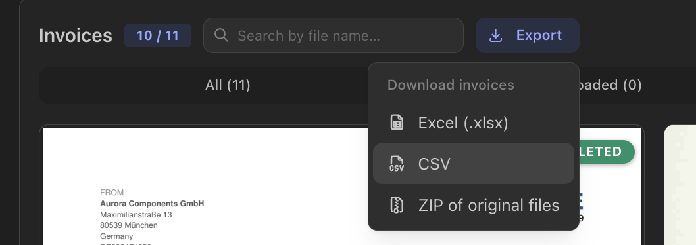 |
| **Runtime engine switch** — pick the extraction & chat engine live<br>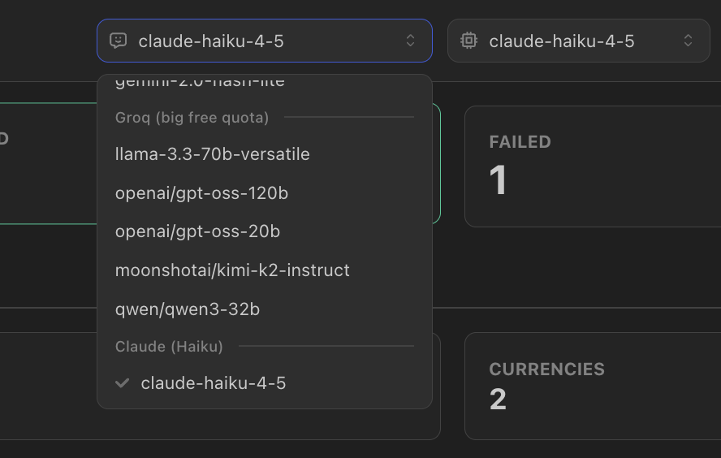 | **Batch upload progress** — the drop zone becomes a grid of per-file mini-cards<br>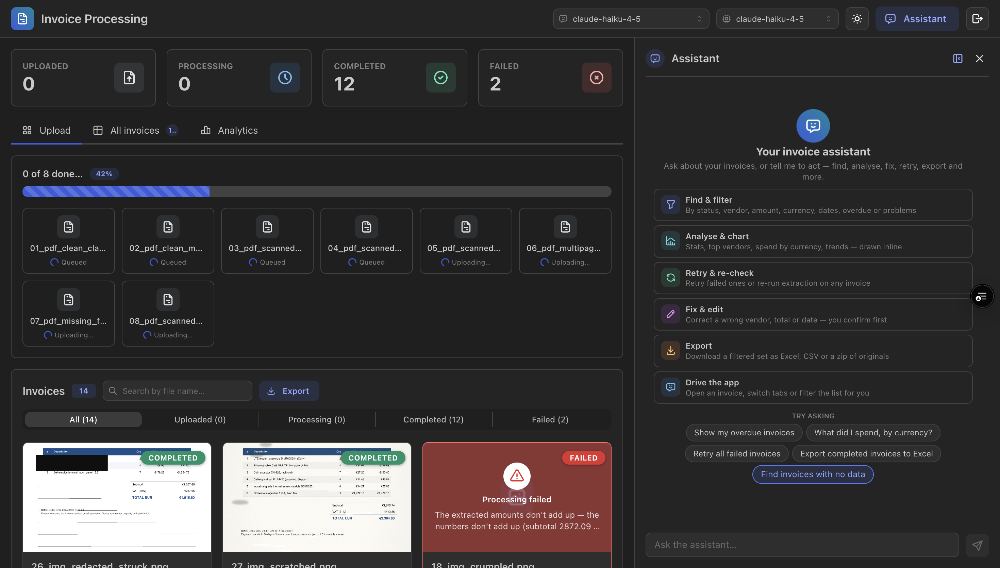 |
| **Upload progress (light)** — same view, light theme, mid-batch<br>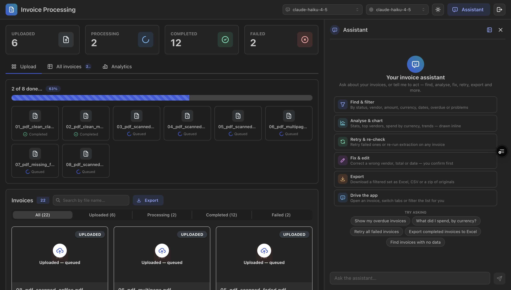 | **Batch finished** — auto-sorted, with a Done button coloured by outcome (4 ok, 2 failed)<br>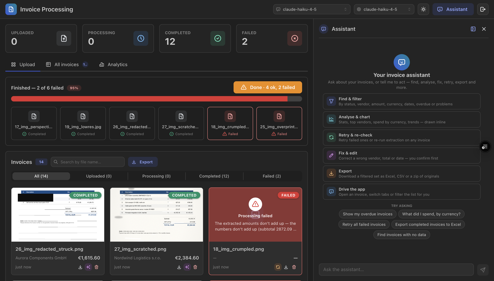 |

## Repository layout

```text
.
├── docker-compose.yml        # postgres, redis, (optional) backend
├── README.md
├── .env.example              # shared infra defaults for docker-compose
├── docs/screenshots/         # UI screenshots used in this README
├── ai-artifacts/             # AI-generated artifacts (kept as-is)
│   ├── context/              # up-front design pack (00–14)
│   ├── claude-design/        # UI mockups (invoice-modal, settings)
│   ├── research/             # external research (hallucination mitigation)
│   └── reviews/              # multi-agent code review + API/adversarial test runs
├── backend/                  # NestJS API + worker
│   ├── src/
│   │   ├── ai/               # Gemini / Groq / Claude services + engine switching
│   │   ├── assistant/        # tool-using chat assistant (answer + act)
│   │   ├── auth/             # username/password login, JWT guard
│   │   ├── events/           # Socket.IO gateway
│   │   ├── invoices/         # entity, REST, service, export (xlsx/csv/zip)
│   │   └── processing/       # BullMQ worker + extraction cascade
│   ├── .env.example
│   └── Dockerfile
└── frontend/                 # React (Vite) UI
    ├── src/
    └── .env.example
```

## Getting started

### Prerequisites

- Node.js 20+
- PostgreSQL 16 and Redis 7 — via Docker Compose, or your own local instances
- At least one AI key (Gemini, Anthropic, or Groq) for extraction/assistant to work

### 1. Infrastructure

With Docker:

```bash
cp .env.example .env
docker compose up -d postgres redis
```

Without Docker, run a local Postgres + Redis on the default ports and create the
database/user that match `backend/.env` (`DATABASE_URL`). TypeORM `synchronize`
creates the schema on first run — no migrations to run.

### 2. Backend

```bash
cd backend
cp .env.example .env     # set at least one AI key; review AUTH_* (default admin/admin)
npm install
npm run start:dev        # http://localhost:3000  (Swagger at /docs)
```

### 3. Frontend

```bash
cd frontend
cp .env.example .env     # VITE_API_URL defaults to http://localhost:3000
npm install
npm run dev              # http://localhost:5173
```

Open <http://localhost:5173>, sign in with **admin / admin**, and upload an
invoice. Sample test invoices (clean, scanned, and deliberately broken) live
under `test-invoices/`.

## Configuration

All backend config is read from `backend/.env` (see `backend/.env.example` for
the full annotated list).

| Key | Purpose |
|-----|---------|
| `AUTH_USERNAME` / `AUTH_PASSWORD` | Demo login. Empty password **disables auth** (dev convenience; logged as a warning). |
| `JWT_SECRET` / `JWT_EXPIRES_IN` | JWT signing. Also HMAC-signs the assistant's delete/edit-confirmation tokens. |
| `DATABASE_URL` | PostgreSQL connection. |
| `REDIS_HOST` / `REDIS_PORT` | Redis connection for BullMQ. |
| `UPLOAD_DIR` / `MAX_UPLOAD_SIZE_MB` | Where files are stored; max upload size (default 10 MB). |
| `GEMINI_API_KEY` / `GEMINI_MODEL` | Enables Gemini (vision extraction + optional chat). |
| `ANTHROPIC_API_KEY` | Enables Claude (`claude-haiku-4-5`) — default extraction primary + assistant. |
| `GROQ_API_KEY` / `GROQ_MODEL` | Enables Groq (assistant chat + PDF-text extraction fallback). |
| `EXTRACTION_MODEL` | Primary extraction engine tried first (default `claude-haiku-4-5`). |
| `ASSISTANT_PROVIDER` | Force the default chat engine (`gemini`/`groq`/`claude`); empty = auto. |
| `EXTRACTION_CONCURRENCY` | How many invoices extract in parallel (default **2**). |
| `EXTRACTION_RATE_MAX` / `EXTRACTION_RATE_DURATION_MS` | Worker rate limit — max jobs per window (default **8 / 60s**); excess jobs are parked, not failed, so AI quota isn't wasted. |

Each AI provider is active only when its key is set. Configure **at least one of
Claude or Gemini** (both do vision extraction); Groq is optional.

## How it works

### Async processing

1. `POST /invoices` (multipart) saves the row as `uploaded`, emits
   `invoice.created`, and enqueues a BullMQ job — the request returns immediately.
2. The `invoice-processing` worker (`@Processor`, concurrency + rate limiter from
   env) marks it `processing` (emits `invoice.updated`), runs extraction, then
   marks it `completed` with the extracted JSON (emits `invoice.updated`).
3. On error BullMQ retries (3 attempts, exponential backoff 5s/10s/20s). Only
   after retries are exhausted is the invoice marked `failed`. Deterministically
   bad input (not an invoice, unreadable, broken math) fails immediately via an
   `UnrecoverableError` instead of wasting retries.
4. `POST /invoices/:id/retry` resets a failed invoice and re-queues it;
   `POST /invoices/:id/reprocess` re-runs extraction on **any** status (to
   re-check a completed invoice whose data looks wrong). The assistant can also
   "retry all failed, then delete the ones that still fail" — a detached watcher
   polls the outcome and emits `invoice.deleted`.

### Extraction cascade

Documents are read by **Claude or Gemini vision**, ordered by the selected
primary engine. If an attempt is weak (not classified as an invoice, low
confidence, missing vendor & total, or totals that don't add up) the next engine
is tried; all attempts are scored and the best result is kept. For PDFs, a final
fallback parses the text layer and runs Groq over it. The winning engine is
recorded as `extractionSource` and shown in the UI. Every attempt is appended to
a live `processingLog` so the detail view shows the pipeline in real time.

### AI assistant (answer + act)

A manual tool-use loop (max 8 turns) runs on the selected engine (Groq / Claude /
Gemini — the same 15-tool surface is converted to each SDK's format). It streams
its progress over SSE (`POST /assistant/messages/stream`), so the chat shows live
steps ("Thinking → Filtering invoices → …") instead of a mute spinner. The send
button becomes a **stop** button while a reply is generating, aborting the
in-flight request on the client.

- **Read / find** — `list_invoices`, `get_invoice`, `search_invoices`,
  `list_empty_invoices`, `query_invoices`, `filter_invoices` (status / vendor /
  amount / currency / dates / overdue / problems / line-items → returns a
  detailed subset to analyse), `get_dataset`, `get_invoice_stats`
- **Act** — `retry_invoice`, `reprocess_invoice`, `retry_all_failed`,
  `retry_failed_then_cleanup`, `update_invoice` (correct a field, gated by a
  before→after confirmation), `delete_invoice` / `delete_invoices` (gated),
  `export_invoices`
- **UI** — `render_chart`, `navigate_ui` (drive tabs/filters/open detail),
  `suggest_actions` (clickable next-step buttons under the reply)

Destructive deletes and field edits return an HMAC-signed token (5-min TTL);
nothing happens until the user clicks **Confirm**. Tools wrap `InvoicesService`,
so the assistant can only reach states the REST API can. **Anti-hallucination**:
every id-taking tool is UUID-guarded with a "look it up first" error, the system
prompt enforces find-then-act, and ungrounded ids are stripped from reply prose
(see [`ai-artifacts/research/hallucination-mitigation.md`](ai-artifacts/research/hallucination-mitigation.md)).

### Frontend

A Mantine dashboard: drag-and-drop **batch upload** where the drop zone itself
turns into an in-place progress indicator — a grid of per-file mini-cards (each
with its own loader/status) that auto-sort finished items to the front, and a
single overall bar. The zone stays disabled while uploading **and** while the
backend queue is still draining, so a new batch can't pile onto work that's
still being extracted. Invoice **cards and a sortable/searchable table** with
status filters (server-paginated); a **detail view** with document preview,
extracted data, retry, "Explain with AI", and export; an **analytics** tab
(charts + on-demand AI insights); and the **assistant chat** — a welcome screen
of capabilities, live streamed steps (with a **force-stop** button to abort a
reply mid-generation), inline charts/stats/invoice-cards, clickable suggestions,
and UI-driving. React Query holds the data; a single Socket.IO subscription
patches the cache from invoice events.

## API

Swagger UI at <http://localhost:3000/docs> (use **Authorize** to paste a JWT).
All endpoints require `Authorization: Bearer <token>` except the two public ones.

| Method & path | Purpose |
|---|---|
| `POST /auth/login` | Sign in, get a JWT. **(public)** |
| `GET /health` | Liveness. **(public)** |
| `POST /invoices` | Upload an invoice (multipart `file`). |
| `GET /invoices` | List invoices — server-side `status`/`search`/`sort`/`dir` with `page`/`limit` pagination (returns `items` + `total`); newest first by default. |
| `GET /invoices/stats` | Aggregate statistics. |
| `GET /invoices/export/:format` | Export filtered invoices — `xlsx` / `csv` / `zip`. Filters: `status`, `vendor`, `minTotal`, `maxTotal`, `search`. |
| `GET /invoices/:id` | Get one invoice. |
| `GET /invoices/:id/file` | Download/preview the original file. |
| `PATCH /invoices/:id` | Correct extracted fields (vendor, total, dates, currency…). |
| `POST /invoices/:id/retry` | Retry a failed invoice. |
| `POST /invoices/:id/reprocess` | Re-run extraction on any-status invoice. |
| `DELETE /invoices/:id` | Delete an invoice + its file. |
| `POST /assistant/messages` | Chat with the assistant (answer + act). |
| `POST /assistant/messages/stream` | Same, streamed live as Server-Sent Events. |
| `POST /assistant/analyze` | AI insights — anomalies + summary. |
| `POST /assistant/invoices/:id/explain` | Plain-language explanation of one invoice. |
| `GET` / `PUT /ai/models` · `/ai/model` | List / switch the primary extraction engine. |
| `GET` / `PUT /ai/assistant-engine` | List / switch the assistant chat engine. |

### Quick smoke test (curl)

```bash
TOKEN=$(curl -s localhost:3000/auth/login -H content-type:application/json \
  -d '{"username":"admin","password":"admin"}' | jq -r .accessToken)
H="-H authorization:Bearer $TOKEN"

curl -s $H localhost:3000/invoices/stats | jq
curl -s $H localhost:3000/assistant/messages -H content-type:application/json \
  -d '{"message":"How many invoices failed?"}' | jq .content
curl -s $H "localhost:3000/invoices/export/xlsx?status=completed" -o invoices.xlsx
```

## Testing

```bash
cd backend && npm run lint
cd frontend && npm run lint
cd frontend && npx tsc --noEmit   # type-check
```

The API surface, broken-file handling, and the assistant's anti-hallucination
guards were exercised against a live backend; the test plans and recorded
results live in [`ai-artifacts/reviews/`](ai-artifacts/reviews/):

- [`02-api-test-plan.md`](ai-artifacts/reviews/02-api-test-plan.md) /
  [`03-api-test-results.md`](ai-artifacts/reviews/03-api-test-results.md) — all
  20 routes + auth/validation (**42/42** passed).
- [`04-broken-file-tests.md`](ai-artifacts/reviews/04-broken-file-tests.md) —
  malformed / empty / oversized / wrong-type uploads (rejected or failed
  gracefully).
- [`05-hallucination-tests.md`](ai-artifacts/reviews/05-hallucination-tests.md) —
  fabricated ids, prompt injection, ungrounded figures (**9/9** held).

Manual acceptance: upload a PDF and watch it go `uploaded → processing →
completed` live; force a failure and use **Retry**; ask the assistant to "show
failed invoices", "retry all failed", "export completed invoices to Excel", and
"delete invoice X" (confirm the prompt). The 52 graded conversational scenarios
in [`13-assistant-test-scenarios.md`](ai-artifacts/context/13-assistant-test-scenarios.md)
are the assistant test plan.

> Note: there is **no automated unit/e2e suite yet** (the `test`/`test:e2e`
> scripts have no spec files) — see *What I'd improve*.

## What I'd improve with more time

These are the highest-value items from the in-repo multi-agent code review
([`ai-artifacts/reviews/00-code-review-report.md`](ai-artifacts/reviews/00-code-review-report.md)):

- **Secret startup guard** — refuse to boot with the `dev-insecure-jwt-secret`
  fallback when auth is on; restrict CORS to an allowlist; add login/assistant
  rate limiting.
- **Atomic retry/reprocess** — add an optimistic-lock `@VersionColumn` to close
  the duplicate-job and lost-update races.
- **Server-side abort on disconnect** — the client can now stop a reply
  (aborts the request), but the backend agentic loop should also cancel when the
  SSE connection drops so an abandoned/stopped session doesn't keep burning AI
  quota server-side.
- **Content-sniff uploads** — verify magic bytes, not just the request MIME type.
- **Migrations instead of `synchronize`**, per-invoice WebSocket rooms, streamed
  xlsx export, and a real automated test suite.

## How AI tools were used

- A **multi-agent Claude workflow** produced the up-front design context pack in
  [`ai-artifacts/context/`](ai-artifacts/context/) (parallel research per area →
  adversarial fact-check → synthesis). Each doc keeps its reviewer's
  "Fact-check & corrections" section verbatim.
- The design evolved during the build: the assistant moved from a Claude-only
  plan to the **multi-engine (Gemini/Groq/Claude)** setup for free-tier quota
  headroom — captured in
  [`12-ai-roadmap.md`](ai-artifacts/context/12-ai-roadmap.md) (which supersedes
  the original assistant spec) and the
  [test scenarios](ai-artifacts/context/13-assistant-test-scenarios.md).
- A second **multi-agent review** (3 Sonnet + 2 Opus reviewers, cross-compared
  and manually verified) audited the finished code — see
  [`ai-artifacts/reviews/`](ai-artifacts/reviews/).
- Claude Code was used throughout implementation for codegen, refactors, and
  reviews; the artifacts are kept **as-is** per the assignment deliverables.

## AI artifacts

All AI-generated artifacts live in [`ai-artifacts/`](./ai-artifacts/):

- [`context/`](ai-artifacts/context/) — the up-front design pack (start with
  [`00-overview.md`](ai-artifacts/context/00-overview.md)).
- [`claude-design/`](ai-artifacts/claude-design/) — UI mockups (invoice modal, settings page).
- [`research/`](ai-artifacts/research/) — external research notes with sources.
- [`reviews/`](ai-artifacts/reviews/) — the multi-agent code review and the
  API / broken-file / hallucination test runs.
